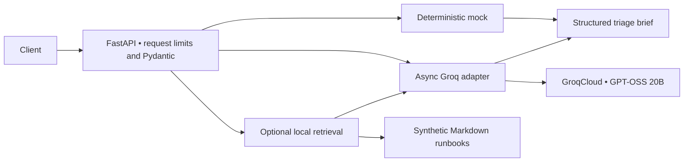
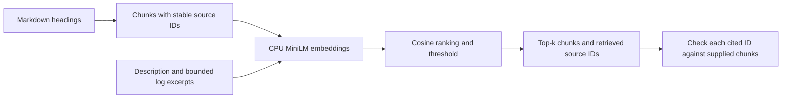
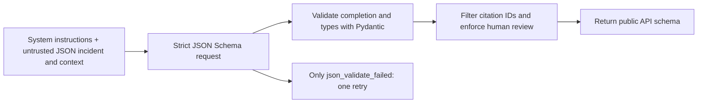

# AI Incident Triage Assistant

[](https://github.com/Ainur-sr/ai-incident-assistant/actions/workflows/ci.yml)

A local-first FastAPI service that turns a synthetic incident report and optional
logs into a triage brief. It helps an engineer decide how urgent an incident is,
which hypotheses are worth investigating, and what evidence to collect next.
It can run deterministic mock analysis offline or use GroqCloud for structured
analysis, with optional local runbook retrieval in either mode.

## Quick start

With Docker Compose on Linux or WSL:

```bash
docker compose --env-file /dev/null up --build --wait
python3 scripts/smoke.py
```

Open the interactive API docs at `http://127.0.0.1:8000/docs`. The default
is mock mode with retrieval disabled. The explicit environment file skips
automatic loading of a project `.env` while allowing exported shell settings.
Stop the service with `docker compose --env-file /dev/null down`.

To use Python 3.14 directly on Linux x86_64:

```bash
python3.14 -m venv .venv
source .venv/bin/activate
python -m pip install -c requirements-lock.txt -r requirements-dev.txt
python -m uvicorn app.main:app
```

### Example

```bash
curl http://127.0.0.1:8000/analyze \
  -H 'Content-Type: application/json' \
  -d '{"description":"Synthetic checkout request timed out."}'
```

```json
{
  "severity": "unknown",
  "summary": "The incident text mentions a timeout.",
  "recommended_actions": [
    "Check dependency latency and error rates around the incident time.",
    "Inspect request traces for the operation associated with the timeout."
  ],
  "needs_human_review": true,
  "limitations": [
    "Rule-based assessment. Verify impact and hypotheses with incident evidence.",
    "No application logs were provided.",
    "A timeout mention alone does not establish a cause or user impact."
  ],
  "likely_causes": [],
  "sources": [],
  "hypothesis_evidence": [],
  "retrieved_sources": []
}
```

`GET /health` returns `{"status":"ok"}` independently of provider or model
availability. `POST /analyze` accepts up to 2,000 description characters and
20,000 log characters. `hypothesis_evidence` pairs each model hypothesis with
its validated `source_ids`. `likely_causes` remains the list of hypothesis text.
`sources` is the union of the cited IDs. `retrieved_sources` lists all candidate
chunks, including those left uncited. Mock mode can return retrieval context
while abstaining from a diagnosis.

## Architecture



### RAG pipeline



### LLM request and validation



A valid citation ID proves the chunk was supplied. Its relevance to the claim
and the claim's fit to the incident require separate review. The prompt asks
the model to abstain when observations are vague, quoted, negated, or
insufficient. The server requires review for high, critical, or unknown severity,
an empty hypothesis list, or dropped citation IDs.

## Optional GroqCloud and RAG

Enable GroqCloud explicitly with synthetic inputs. The provider receives the
description, logs, and any retrieved excerpts. Calls can consume quota.

```bash
read -rsp 'Groq API key: ' GROQ_API_KEY; printf '\n'
export GROQ_API_KEY
ANALYSIS_MODE=groq docker compose --env-file /dev/null up --build --wait
```

`GROQ_MODEL` defaults to `openai/gpt-oss-20b` and must support strict Structured
Outputs. For direct Python execution, use `ANALYSIS_MODE=groq python -m uvicorn app.main:app`.

To cache the public model in the Docker volume and run retrieval offline:

```bash
INSTALL_RAG=true docker compose --env-file /dev/null build api
INSTALL_RAG=true docker compose --env-file /dev/null run --rm -e HF_HUB_OFFLINE=0 api \
  python -c 'from sentence_transformers import SentenceTransformer; SentenceTransformer("sentence-transformers/all-MiniLM-L6-v2", device="cpu", token=False)'
INSTALL_RAG=true RAG_ENABLED=true docker compose --env-file /dev/null up --wait
python3 scripts/smoke.py --rag
```

Set `RAG_TOP_K` to change the default of three chunks. For native CPU RAG setup,
see the [evaluation guide](evals/README.md).

## Published benchmark

Historical Groq-hosted GPT-OSS 20B A/B run on 30 synthetic cases per arm.
The [archived reports and checksums](evals/benchmarks/v1/README.md) include
per-case outcomes, packages, settings, failures, and uncertainty denominators.

| Metric | Without RAG | With RAG |
| --- | ---: | ---: |
| Valid analyses delivered | 26/30 | 26/30 |
| Paired severity accuracy | 14/22 | 15/22 |
| Paired leading-cause accuracy | 18/22 (81.82%) | 20/22 (90.91%) |
| Leading-cause accuracy on each arm’s successes | 21/26 | 24/26 |
| Correct leading cause per scheduled case | 21/30 | 24/30 |
| Terminal `json_validate_failed` | 4/30 | 4/30 |
| Review flag plus limitations on successful uncertainty cases | 2/3 | 0/2 |

Offline document retrieval yielded Recall@1 of 91.67%, Recall@3 of 100%, and
MRR of 0.9722 over 24 positive cases. One of six negatives retrieved a document.
The production path ranks chunks. The historical run predates the current
prompt, attribution, and retry changes. A fresh live evaluation is needed to
measure their effect. The [evaluation guide](evals/README.md) covers offline
rescoring and reproducible claim-level review.

## Tests and trade-offs

```bash
HF_HUB_OFFLINE=1 python -m pytest
```

Push and pull request CI runs offline tests and checks both Docker endpoints.
The separate **RAG Docker smoke** workflow is manually triggered. It downloads
the public embedding model and then exercises retrieval in mock mode. Both
workflows omit Groq credentials. Version constraints pin the runtime, test, and
optional CPU RAG dependency graphs for Linux x86_64 and Python 3.14. They pin
versions rather than wheel hashes or container digests. See the
[engineering notes](docs/reliability.md) for the audit and verification commands.

The corpus is small, the ranking threshold is fixed, and the leading-cause
metric uses lexical categories. The service binds locally by default and has
request and concurrency limits. A public deployment would need authentication,
per-user quotas, redaction and operational monitoring. Future work includes
repeating the live benchmark, checking claim support with independent reviewers,
pinning model and image revisions, and calibrating retrieval on a held-out set.

## Repository map

| Path | Role |
| --- | --- |
| `app/` | FastAPI, Pydantic schemas, mock analysis, Groq SDK, NumPy retrieval |
| `runbooks/` | Synthetic Markdown corpus |
| `evals/` | Synthetic dataset, scorer, and benchmark artifacts |
| `tests/` | Offline tests with pytest, HTTPX, and provider doubles |
| `scripts/smoke.py` | Local HTTP checks for Docker Compose |
| `.github/workflows/` | Offline CI and manual CPU RAG smoke |
